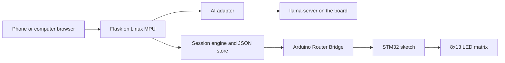

# Outmark build plan

This document is the implementation contract for Outmark. The product spec in [docs.md](../docs.md) and the Arduino UNO Q user manual are the sources of truth. Where they disagree with an unverified third-party claim, this plan follows the official manual and records the gap.

Stage 0 records the architecture, stage sequence, constraints, test strategy, and risks. It does not add application code.

## Repository audit

Checked on the development machine (macOS arm64, Python 3.14.5) before this document was written.

| Item | Finding |
| --- | --- |
| Workspace | Only `docs.md`. No application, sketch, tests, or dependency files. |
| Git | No repository existed. Stage 0 initializes `main` and makes this documentation commit. Nothing is pushed. |
| Local tooling | `flask` and `arduino-cli` are not installed on this machine. |
| Hardware | The UNO Q is not attached. No matrix, Bridge, button, or inference check has been run on the board. |
| Target runtime | The Project Hub local-LLM example for UNO Q uses Python 3.13, `llama.cpp`, and Flask on the board's Debian image. Development tests must stay compatible with that environment and must not require Python 3.14-only syntax. |

## Architecture



The Linux processor is authoritative for commitments, timing, history, and what the display should show. The STM32 only renders a validated display state. The language model only proposes language. It never starts a timer, marks a session complete, or writes LED frames.

### Linux processor

- Python application and Flask web server.
- Local open-weight inference behind a replaceable adapter.
- Commitment generation, rejection, acceptance, and session management.
- Persistent timer state and a local JSON file.
- Activity-history calculations and the 8 by 13 grid.
- Compact, validated messages to the microcontroller.

### STM32 microcontroller

- LED matrix rendering with `Arduino_LED_Matrix`.
- One display mode at a time: idle, pending, active progress, timer-elapsed, or history.
- Optional RGB status on the MCU-controlled LEDs. The matrix alone must remain sufficient.
- No blocking waits for the session timer. `loop()` stays free to service the bridge.

### Communication

Use Arduino Router Bridge, not a private serial port.

- The router claims `/dev/ttyHS1`. Application code must not open that device.
- Inside an App Lab app, Python calls the MCU with `from arduino.app_utils import Bridge` and `Bridge.call(...)`.
- The sketch exposes display functions with `Bridge.provide_safe`, because drawing uses Arduino APIs and must run on the main loop context. `Bridge.provide` runs on the RPC thread and is the wrong choice for matrix updates.
- Do not call `Bridge.call`, `Monitor.print`, or `Serial.print` from inside a `provide` handler.
- The user manual also documents a raw MessagePack client on `/var/run/arduino-router.sock` for Linux programs that are not using `arduino.app_utils`. Outmark prefers the App Lab `Bridge` helper. The socket client is a fallback only if the helper cannot be imported from the Flask process, and that fallback still has to be proven on the board.

### App layout

Arduino App Lab apps use this layout, from the [app specification](https://github.com/arduino/arduino-app-cli/blob/main/docs/app-specification.md):

```text
app.yaml
python/main.py
python/requirements.txt
sketch/sketch.ino
sketch/sketch.yaml
```

`python/main.py` is the board entry point. Domain logic lives in an importable package so pytest can run on a computer that has neither the board nor the model. The sketch filenames stay `sketch.ino` and `sketch.yaml`.

App Lab publishes web ports through `app.yaml`. A Project Hub on-device agent notes that apps can run in a container that does not see the host's `127.0.0.1`, and that a host model is reached through `HOST_IP`. That behavior is unverified here. Stage 4 must measure it on the board before treating either URL as correct.

### Frontend

HTML, CSS, and vanilla JavaScript served by Flask. Category names, dates, instructions, and reflections stay on the page. The matrix does not render text.

## Module boundaries

Later stages should keep these pieces separate. Stage 0 does not create the files.

| Module | Responsibility |
| --- | --- |
| Web routes | Validate HTTP input, call the engine, return JSON or HTML. No prompt text and no direct hardware calls. |
| Session engine | Proposals, accept, reject, timer, report, illegal transitions. |
| Storage | Atomic JSON read and write. Full history stays on disk. The 13-day grid is a view. |
| Clock | Wall-clock timestamps for persistence. A monotonic clock for elapsed time inside one process. |
| History | Map `kept` sessions onto eight rows and thirteen day columns. |
| Prompts | System prompt and request shaping, separate from validation and from the engine. |
| AI adapter | One method that returns a structured activity or a typed failure. The caller never trusts raw model text. |
| Fallback catalog | Deterministic activities used when inference or validation fails. |
| Display protocol | Turn engine state into a mode plus eight 13-bit masks. Reject out-of-range values before they are sent. |
| Bridge display | Send that protocol on the board. Tests use an in-memory stand-in. |
| Sketch | Store the latest mode, progress, and masks, and redraw. No session rules. |

## State machine

Acceptance, rejection, timer expiration, and completion reporting are different events. An expired timer is not a completed activity.

| State | How it is entered | Timer | History cell | Matrix |
| --- | --- | --- | --- | --- |
| `proposed` | User asks for an activity and generation or the fallback catalog returns a valid one | Not started | Unchanged | Stays on the current idle or history view |
| `rejected` | User rejects the current proposal | Not started | Unchanged | Unchanged |
| `active` | User explicitly accepts a proposal | Started and persisted | Unchanged until a report | `PENDING`, then `ACTIVE` progress |
| still `active`, deadline passed | Derived from timestamps. Status is not rewritten to completed | Stopped at the deadline for display purposes | Unchanged | `DONE` |
| `kept` | User explicitly reports that they kept the commitment | Closed | One cell set for that category and local calendar day | `GRID` |
| `not_kept` | User explicitly reports that they did not keep it | Closed | Unchanged. Earlier cells stay lit | `GRID` |

Rules:

- Rejection does not create an active session and does not start a timer. The user can request another suggestion.
- Acceptance is the only event that creates an active session.
- A second accept, reject, or report on a state that does not allow it is an error and does not change stored data.
- Closing the browser does not change status. Restarting the Python process restores `active` sessions from timestamps.
- Only `kept` illuminates a cell. Several kept activities in the same category on the same local day still produce one lit cell. Counts and reflections remain in the JSON history.
- A `not_kept` report is stored. It does not clear other cells and it does not reset the grid.
- The model cannot set any of these states.

Elapsed time inside a running process is `monotonic_now - monotonic_at_start`, clamped to the duration. Both a wall-clock `started_at` and the duration are what get stored. A monotonic reading does not survive a process restart, so recovery uses the wall-clock start time. Clock steps during a live process are why the in-process path prefers the monotonic clock.

## Matrix and Bridge contract

The display is an 8 by 13 monochrome blue LED matrix. The user manual draws a frame as 104 values, row-major: thirteen entries, then the next row. Index 0 is the first entry of the first row in that example.

Mapping used by Outmark, pending a physical check of which board edge is row 0:

| Frame row | Category id | Category |
| --- | --- | --- |
| 0 | `walking` | Walking and movement |
| 1 | `nature_observation` | Nature observation |
| 2 | `quiet_outdoor` | Quiet outdoor time |
| 3 | `social` | Social connection |
| 4 | `outdoor_care` | Outdoor care or helping |
| 5 | `exploring` | Exploring a new place |
| 6 | `creative_observation` | Creative observation |
| 7 | `other` | Other offline experiences |

Day columns in the rolling window:

- Column 0, the first entry in each row, is the oldest day.
- Column 12 is the local calendar day of "today" when the grid is rendered.
- Days older than the window leave the grid view. They stay in the JSON file.

Each history row crosses the bridge as one integer mask. Bit 0 is column 0. Bits 13 and above are illegal and must be rejected before a call. The sketch stores eight masks and redraws when the mode or a mask changes.

Display modes, one at a time:

| Mode | When | What the matrix shows |
| --- | --- | --- |
| `REST` | No active session and no history cells in the window | A small idle mark |
| `GRID` | No active session, and at least one kept cell is in the window | The 13-day history |
| `PENDING` | Session just accepted, before progress advances | A pattern that is not the history grid and not the progress bar |
| `ACTIVE` | Timer running | A compact bar of up to 13 segments from elapsed divided by duration |
| `DONE` | Deadline has passed and the user has not reported | A small completed-timer mark. This is not a kept cell |

Suggested RPC names, to be confirmed against the types MessagePack actually accepts on the board:

- `set_mode(mode_id)` with a small integer, not a free-form string from the model.
- `set_progress(segments)` with an integer from 0 through 13.
- `set_grid_row(row, mask)` with `row` from 0 through 7 and `mask` from 0 through 8191.

The sketch validates those ranges again. A failed or missing bridge call must not roll back or corrupt the JSON session.

RGB LEDs are optional. Four RGB LEDs exist: two on the Qualcomm side (`arduino.app_utils.Leds` or `/sys/class/leds`) and two on the STM32 (`LED3_*`, `LED4_*`, active low). LED 2 is also a system status indicator. The MVP must not depend on RGB. If used, prefer LED 1 or the MCU LEDs, and avoid fighting the system use of LED 2 until that is checked on hardware.

## Local model

The adapter has one job: given duration, preferred category, and a short list of recent activities and reflections, return validated JSON with `title`, `instructions`, `reflection_question`, and `category`. The category must be one of the eight ids above. Duration is 5, 10, or 15 minutes. Instructions stay short, local, equipment-free, and safe: no trespassing, no wildlife disturbance, no plant collecting, no private property, no strangers, no money, no internet, and no photography required.

Initial runtime, reused from the documented UNO Q local chatbot rather than a new inference stack:

- `llama-server` from `llama.cpp`.
- OpenAI-compatible `POST /v1/chat/completions` on the board.
- First model candidate from the product spec: [Qwen2.5-0.5B-Instruct Q4_K_M](https://huggingface.co/Qwen/Qwen2.5-0.5B-Instruct-GGUF) (Apache 2.0, about 491 MB).
- If that GGUF fails on the board's `llama.cpp` build, switch the adapter configuration to SmolLM2-360M-Instruct Q4_K_M, which is the model in the Project Hub chatbot example. Do not add a second runtime to make the first model work.

Malformed JSON, an unknown category, an empty instruction, or a transport failure selects the next unused fallback activity for the requested duration and category. The core timer and history still work when the model is absent. Weights, the runtime build, and `data/` stay out of Git.

No fine-tuning, vector database, agent framework, or extra model unless a later measured failure shows the single local model cannot do this task. No API keys.

## Data

One JSON document, written by creating a temporary file and replacing the destination. Illustrative shape:

```json
{
  "settings": {"default_duration": 10},
  "proposals": [],
  "sessions": [
    {
      "id": "session-001",
      "started_at": "2026-10-10T12:00:00+05:45",
      "duration_minutes": 10,
      "category": "nature_observation",
      "title": "Notice the Small Things",
      "quest": "Find three different leaf patterns.",
      "status": "kept",
      "reflection": "I noticed a different pattern on each leaf.",
      "reported_at": "2026-10-10T12:15:00+05:45"
    }
  ]
}
```

`started_at` and `reported_at` are real timestamps when implementation begins. The example above is only a shape. Reflections stay in this file on the device.

## Button

The UNO Q user manual describes the onboard control as a power button. A press of 5 seconds or longer reboots the Linux side. The board boots when it receives power; the button is not required to turn it on. The manual does not document a short-press event for applications.

A third-party board guide claims a user button whose short press is reserved for apps and whose custom handling is under development. That claim is not an API this project can call. Header-pin button examples are for an external switch, and this MVP adds no extra hardware.

Acceptance, rejection, another suggestion, and completion reporting are webpage actions. The matrix still follows session state. This limit does not block the other stages. Do not bind a workflow step to an undocumented press.

## Stage sequence

Each stage gets one commit after its checks pass. Do not combine stages. Do not commit a stage that does not meet its criteria. If the board is unavailable, simulated checks can pass and the physical checks stay listed as not run.

### Stage 0 — Repository and documentation audit

**Commit:** `docs: define Outmark implementation plan`

**Acceptance:**

- Existing spec, Git state, and documented UNO Q APIs have been inspected.
- This file states the architecture, stages, constraints, test strategy, and risks.
- Hardware assumptions that still need the board are labeled as unverified.
- The commit contains this plan and the existing product spec, and no application code.

**Status:** complete in this commit.

**Checks:** repository inspection and documentation review on the development machine. Formatters, static checks, and pytest are not applicable because there is no application yet. No physical board test was run.

### Stage 1 — Project foundation

**Commit:** `feat: scaffold Outmark application`

**Acceptance:**

- App Lab layout exists, with domain code importable without the board.
- Flask serves `GET /health` and a first local page.
- Configuration, logging, dependency pins, and local data paths are defined.
- The process starts when the model is not installed.
- A README explains how to run the health check.
- Automated tests cover import and the health route.
- `data/`, `models/`, virtual environments, and secrets are gitignored.

**Status:** complete in this commit.

**Checks performed:**

- `ruff check python tests` passed.
- `ruff format --check python tests` passed.
- `pytest`: 5 passed on Python 3.14.5. The health check passes when `models/` does not exist.
- Browser: loaded the home page on this machine. The status line reported that the local service is running and that activity generation waits until a model file is installed. `GET /health` returned `data_dir_ready: true`, `model_present: false`, and `status: ok`.
- Port 8080 on this development machine was already taken by another local web server, so the browser check used `OUTMARK_PORT=7000`. The App Lab manifest still publishes 8080.

**Known limitations:**

- `sketch/` is not in this commit. The matrix sketch belongs to stage 3.
- The app was not opened in App Lab and was not run on the UNO Q.
- The process uses Flask's built-in server.
- No model weights were installed. Startup succeeded without them.

### Stage 2 — Commitment and session engine

**Commit:** `feat: implement commitment and session lifecycle`

**Acceptance:**

- Models exist for category, proposal, session, and completion report.
- Accept starts a persisted active session. Reject does not.
- Expiry is derived and does not write `kept`.
- Incomplete reports persist and leave older kept cells in place.
- Restart restores an active session from timestamps.
- Illegal and duplicate transitions fail closed.
- Tests cover accept, reject, duplicates, expiry, incomplete sessions, persistence, and recovery.
- No matrix and no model calls in this stage.

**Status:** complete in this commit.

**Checks performed:**

- `ruff check python tests` passed.
- `ruff format --check python tests` passed.
- `pytest`: 18 passed on Python 3.14.5. The new tests cover accept, reject, duplicate transitions, monotonic elapsed time, wall-clock recovery, expiry without a `kept` write, a `not_kept` report that leaves older cells lit, and a corrupt file that is left untouched.
- The webpage was not changed, so there was no new browser flow to exercise.

**Known limitations:**

- The Flask page still does not accept, reject, or report. Those routes belong to stage 5.
- No matrix update is sent. No model is called. A proposal is created from an already validated activity draft.
- Display elapsed time is clamped to the session duration. The stored status stays `active` until an explicit report.
- Not run on the UNO Q.

### Stage 3 — UNO Q matrix integration

**Commit:** `feat: integrate UNO Q LED matrix`

**Acceptance:**

- The sketch implements the modes and mask contract above without blocking.
- Linux sends validated masks and mode updates through the documented bridge path.
- Application tests use a fake display and do not need the board.
- Any check that was not run on hardware is listed here as not run. A passing unit test is not a passing matrix test.

**Status:** complete in this commit for the software contract. The physical matrix was not tested.

**Checks performed:**

- `ruff check python tests` passed.
- `ruff format --check python tests` passed.
- `pytest`: 27 passed on Python 3.14.5. Display tests use an in-memory stand-in. They check mode selection, the 13-bit masks, the 104-pixel frame rules, rejection of an out-of-range mask, and that a failed display call leaves the JSON file unchanged.
- The webpage was not given new controls, so there was no new browser flow.

**Not run on hardware:**

- The sketch was not compiled or flashed.
- No LED was observed. Row 0, column 0, and the pending, active, done, and idle patterns are unverified on the glass.
- `Bridge.call` integer arguments were not confirmed against the board's MessagePack types.
- `sketch/sketch.yaml` copies RouterBridge 0.3.0 and its dependencies from Arduino's led-matrix-painter example. Those versions were not resolved on this machine.
- RGB LEDs are unused.

### Stage 4 — Local open-weight AI

**Commit:** `feat: add local AI activity generation`

**Acceptance:**

- The adapter is replaceable. Prompts live outside the engine.
- Generation uses the local runtime. Responses are parsed and validated.
- Bad output and inference failure use the fallback catalog.
- Reflections are stored locally.
- Runtime does not call an external model API.
- Latency and memory are measured on the board when the board is available. If it is not, the commit says that measurement was not done.
- No fine-tuning, vector database, agents, or extra models.

**Status:** complete in this commit for the software contract. Latency and memory were not measured on the UNO Q.

**Checks performed:**

- `ruff check python tests` passed.
- `ruff format --check python tests` passed.
- `pytest`: 37 passed on Python 3.14.5. The ten new generator tests use a scripted chat client and one local loopback HTTP server. They check that the requested duration wins over model JSON, fenced JSON is accepted, malformed output, a bad category, empty instructions, and a completion claim fall back to the catalog, a transport error avoids a recent title, a public model URL is not called, an invalid duration is rejected before any call, a stored reflection is included in the next prompt and is not rewritten by generation, the request carries no API key, and startup does not contact the model.
- No new webpage route was added.

**Not run on hardware:**

- `llama-server` was not started. No GGUF was downloaded. Generation latency and memory use were not measured.
- Whether an App Lab container can reach a host model on `127.0.0.1:8081` or only through `HOST_IP` was not checked.
- The fallback catalog was not compared with a live Qwen2.5-0.5B-Instruct response.

### Stage 5 — Complete user experience

**Commit:** `feat: integrate complete Outmark workflow`

**Acceptance:**

- The page shows one proposal before accept, supports another suggestion after reject, shows the running timer, and requires an explicit kept or not-kept report.
- History and reflections are visible.
- Valid state changes update the display adapter.
- Loading, error, and model-unavailable states are visible.
- The page and the display both follow the stored session, including after a reload.

**Status:** complete in this commit for the software contract. The physical matrix was not updated from the page.

**Checks performed:**

- `ruff check python tests` passed.
- `ruff format --check python tests` passed.
- `pytest`: 48 passed on Python 3.14.5. The webpage tests use a scripted activity source and an in-memory display. They check one proposal at a time, another suggestion after reject, timer progress, a deadline that stays `active`, a kept report that lights one cell and stores a reflection, a not-kept report that does not light a cell, invalid input that does not write a file, a failed matrix call that keeps the accepted session, and a corrupt store that is not rewritten.
- In a browser on this computer, against `http://127.0.0.1:8765` with no model file and no bridge: the page showed the missing-model note, the loading line, one catalog suggestion, reject, a second suggestion, a running timer, a kept report with its reflection, the same history after reload, a not-kept report that left the earlier cell lit, and the duration error for a value outside 5, 10, and 15.

**Not run on hardware:**

- No LED changed. The browser session had no Arduino Bridge.
- The page was not driven through a live `llama-server` response. The browser path used the catalog after the local model request failed.

### Stage 6 — Reliability and offline validation

**Commit:** `test: harden Outmark and verify offline behavior`

**Acceptance:**

- Automated tests pass.
- Malformed model output and inference failure take the fallback path.
- Restart restores sessions and does not auto-complete them.
- Reject does not start a timer.
- The 13-day window rolls forward without deleting stored sessions.
- A failed display update does not corrupt the JSON file.
- The write-up separates automated tests, simulated hardware tests, and tests actually run on the board.
- Setup notes match the commands that were actually used.

### Stage 7 — Documentation and demo readiness

**Commit:** `docs: finalize Outmark setup and demo guide`

**Acceptance:**

- README covers hardware setup, model download, license, runtime, architecture, and the state machine.
- Button limits and the webpage alternative are documented.
- Privacy, self-reported completion, and known limits are explicit.
- A short demo script matches the definition of done below.
- A new developer can follow the steps that were verified. Unverified board steps stay marked as unverified.

## Test strategy

Three layers, reported separately:

1. **Automated.** pytest on the development machine for the engine, storage, grid math, AI response validation, fallback selection, and the fake display. These do not claim the LED matrix lit up.
2. **Simulated hardware.** An in-memory bridge records `set_mode`, `set_progress`, and `set_grid_row` and rejects illegal values. This checks the protocol, not the glass and the LEDs.
3. **Physical board.** Required before claiming the product works on the UNO Q: frame orientation, Bridge integer arguments, App Lab port reachability from a phone or computer, `HOST_IP` versus localhost for `llama-server`, inference latency and memory, JSON survival across an app restart, and a real 13-day cell. None of these have been run.

The health check and session tests must pass with no model files present.

## Definition of done

The MVP is done when this sequence is real, not only tested with fakes:

1. Start Outmark on the UNO Q.
2. Generate an activity with the local open-weight model.
3. Reject it and generate another.
4. Accept one and start the timer.
5. Close the browser and confirm the timer continues.
6. Return and explicitly report the outcome.
7. Confirm the history file still contains the session.
8. Confirm the matching matrix cell changed.
9. Restart the application and confirm the records remain.
10. Disconnect external internet after setup and confirm the core path still works.

Until the board is available, stages may land with automated and simulated coverage only. The plan must keep saying which physical checks are still open.

## Risks still requiring the board

| Risk | Why it is open | Planned response |
| --- | --- | --- |
| Matrix orientation | The manual shows a logical 8 by 13 frame. It does not state which physical edge is row 0. | Draw a one-pixel probe and correct the row or column map if the lit LED is not where this plan assumes. |
| Bridge argument types | MessagePack examples in the manual use booleans. Row masks are integers. | Send the mask with the App Lab `Bridge.call` and confirm the sketch receives 0 through 8191. Fall back to a documented numeric type only if the integer is corrupted. |
| App Lab networking | Container apps may not see host `127.0.0.1`, and the web port must be published. | Declare the Flask port in `app.yaml`. Point the adapter at `HOST_IP` only after a board check. Keep generation optional so the timer still runs. |
| Model weight and speed | Qwen2.5-0.5B Q4_K_M is the spec candidate, not a measurement. | Time one short generation and watch memory. Switch the adapter to SmolLM2-360M Q4_K_M if the first model does not load. Use the fallback catalog either way on failure. |
| Persistence across the app runtime | An App Lab container filesystem may not keep `data/` where a developer expects. | Store JSON on a path that survives restart, then restart the app on the board and read the file back. |
| Power button | Long press reboots Linux. Short press is not a documented application event. | Leave input on the webpage. |
| Router conflicts | Opening `/dev/ttyHS1` breaks the bridge. | Use only `arduino.app_utils.Bridge` or the documented router socket. |

## Out of scope

No location tracking, camera verification, speech, accounts, cloud sync, pixel-art game, extra models, fine-tuning, or punishment animation. A missed day does not erase earlier marks.

## Stage 0 limitations

- No formatter, linter, or pytest run. There is no Python package yet.
- No sketch was compiled.
- No model was downloaded and no inference was timed.
- The button conclusion is from the official user manual, not from a press test on this board.
- The matrix row, column, and mask mapping is a documented assumption until a one-pixel board test.
